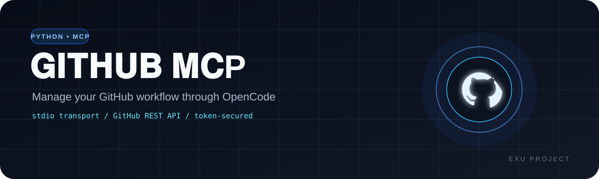
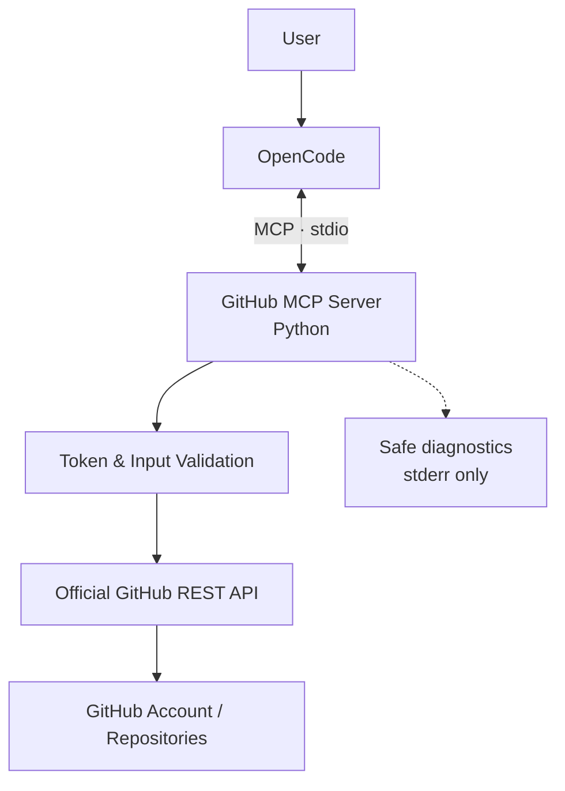
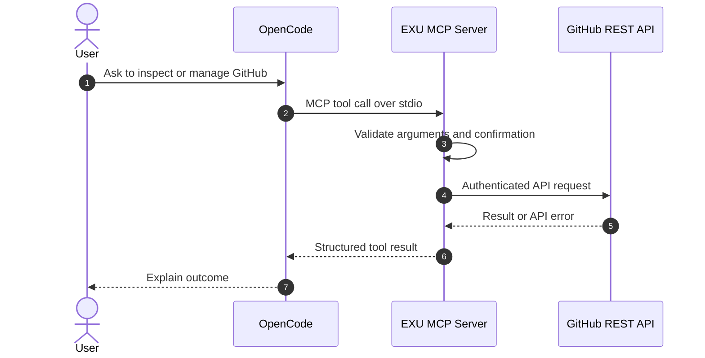

# 𝐆𝐈𝐓𝐇𝐔𝐁  𝐌𝐂P

<p align="center"></p>


**𝐘𝐨𝐮𝐫 𝐆𝐢𝐭𝐇𝐮𝐛 𝐰𝐨𝐫𝐤𝐟𝐥𝐨𝐰. 𝐎𝐧𝐞 𝐏𝐲𝐭𝐡𝐨𝐧 𝐌𝐂𝐏 𝐬𝐞𝐫𝐯𝐞𝐫. 𝐃𝐢𝐫𝐞𝐜𝐭𝐥𝐲 𝐢𝐧 𝐎𝐩𝐞𝐧𝐂𝐨𝐝𝐞.**

`GitHub MCP` is a local Model Context Protocol (MCP) server that connects OpenCode to the official GitHub REST API over **stdio**. Use natural-language requests to inspect and manage repositories, branches, issues, pull requests, files, collaborators, and releases.

> [!IMPORTANT]
> This project is not affiliated with GitHub, Inc. GitHub permissions and organization policies still apply. Review every write operation before confirming it, and use a fine-grained token with the minimum permissions needed.

---

## 📖 𝐎𝐕𝐄𝐑𝐕𝐈𝐄𝐖

The server runs locally as a child process of OpenCode. MCP messages use standard input/output; diagnostic messages must not be written to stdout because stdout is reserved for the protocol.

### ✨ 𝐂𝐎𝐑𝐄 𝐅𝐄𝐀𝐓𝐔𝐑𝐄𝐒

| 𝐅𝐞𝐚𝐭𝐮𝐫𝐞 | 𝐃𝐞𝐬𝐜𝐫𝐢𝐩𝐭𝐢𝐨𝐧 |
|---|---|
| 👤 𝐀𝐜𝐜𝐨𝐮𝐧𝐭 𝐏𝐫𝐨𝐟𝐢𝐥𝐞 | Read the authenticated GitHub account profile. |
| 📦 𝐑𝐞𝐩𝐨𝐬𝐢𝐭𝐨𝐫𝐢𝐞𝐬 | List, inspect, create, update, fork, bulk-fork (limited batch), and confirm-before-delete repositories. |
| 🌿 𝐁𝐫𝐚𝐧𝐜𝐡𝐞𝐬 | List branches and create a branch from an existing ref. |
| 🐛 𝐈𝐬𝐬𝐮𝐞𝐬 | List, create, and update issues. |
| 🔀 𝐏𝐮𝐥𝐥 𝐑𝐞𝐪𝐮𝐞𝐬𝐭𝐬 | List, create, and merge pull requests with explicit confirmation. |
| 📝 𝐑𝐞𝐩𝐨 𝐅𝐢𝐥𝐞𝐬 | Read text files and commit file changes after confirmation. |
| 🤝 𝐂𝐨𝐥𝐥𝐚𝐛𝐨𝐫𝐚𝐭𝐨𝐫𝐬 | List, invite, and remove collaborators with validation and confirmation. |
| 🚀 𝐑𝐞𝐥𝐞𝐚𝐬𝐞𝐬 | List and create draft releases. |
| 🔐 𝐒𝐞𝐜𝐮𝐫𝐢𝐭𝐲 | Token-based authentication, input validation, safe error handling, and explicit confirmation for sensitive actions. |

---

## 🏗️ 𝐒𝐘𝐒𝐓𝐄𝐌 𝐀𝐑𝐂𝐇𝐈𝐓𝐄𝐂𝐓𝐔𝐑𝐄



## 🔄 𝐓𝐎𝐎𝐋 𝐂𝐀𝐋𝐋 𝐋𝐈𝐅𝐄𝐂𝐘𝐂𝐋𝐄



---

## ⚙️ 𝐑𝐄𝐐𝐔𝐈𝐑𝐄𝐌𝐄𝐍𝐓𝐒

- **Python:** 3.11 or newer
- **Client:** OpenCode with local MCP support
- **GitHub authentication:** Fine-grained Personal Access Token
- **Network:** Internet access to `api.github.com`
- **Packages:** listed in [`requirements.txt`](requirements.txt)

### 📁 𝐏𝐑𝐎𝐉𝐄𝐂𝐓 𝐒𝐓𝐑𝐔𝐂𝐓𝐔𝐑𝐄

```text
github-mcp/
├── server.py              # MCP tools and GitHub API client
├── requirements.txt       # Python dependencies
├── pyproject.toml         # Project metadata
├── .env.example           # Safe environment template
├── .gitignore             # Excludes secrets and virtualenv
├── opencode.example.json  # OpenCode MCP configuration example
└── README.md              # Documentation
```

---

## 🚀 𝐐𝐔𝐈𝐂𝐊 𝐒𝐓𝐀𝐑𝐓 — 𝐖𝐈𝐍𝐃𝐎𝐖𝐒

Open PowerShell in the project directory:

```powershell
py -3.11 -m venv .venv
.\.venv\Scripts\python.exe -m pip install --upgrade pip
.\.venv\Scripts\python.exe -m pip install -r requirements.txt
Copy-Item .env.example .env
notepad .env
```

Edit `.env` and add your token:

```dotenv
GITHUB_TOKEN=github_pat_REPLACE_ME
GITHUB_TIMEOUT=30
```

Do not share or commit `.env`. If a token is accidentally exposed, revoke it in GitHub settings and create a replacement.

### 🐧 𝐋𝐈𝐍𝐔𝐗 / 𝐌𝐀𝐂𝐎𝐒

```bash
python3 -m venv .venv
. .venv/bin/activate
python -m pip install --upgrade pip
python -m pip install -r requirements.txt
cp .env.example .env
chmod 600 .env
${EDITOR:-nano} .env
```

---

## 🔑 𝐆𝐈𝐓𝐇𝐔𝐁 𝐓𝐎𝐊𝐄𝐍 𝐏𝐄𝐑𝐌𝐈𝐒𝐒𝐈𝐎𝐍𝐒

Create a fine-grained token in **GitHub → Settings → Developer settings → Personal access tokens → Fine-grained tokens**. Limit its resource owner and repository access. Select only the permissions needed for the tools you will use.

| 𝐏𝐞𝐫𝐦𝐢𝐬𝐬𝐢𝐨𝐧 | 𝐔𝐬𝐞 |
|---|---|
| Metadata — Read | Basic repository metadata; typically required. |
| Contents — Read / Write | Read repository files and commit file changes. |
| Issues — Read / Write | Read and manage issues. |
| Pull requests — Read / Write | Read, create, and manage pull requests. |
| Administration — only when needed | Repository settings, deletion, and some collaborator administration. |
| Contents / Metadata permissions as required | Branch and release operations, depending on the endpoint and repository. |

Permissions vary by endpoint, repository ownership, and organization policy. Do not grant broad access “just in case.” GitHub may require organization approval for a token.

---

## 🔌 𝐎𝐏𝐄𝐍𝐂𝐎𝐃𝐄 𝐂𝐎𝐍𝐅𝐈𝐆𝐔𝐑𝐀𝐓𝐈𝐎𝐍

Merge this entry into your existing OpenCode config instead of replacing unrelated settings. Replace the example paths with the real absolute paths on your computer.

### 𝐖𝐢𝐧𝐝𝐨𝐰𝐬 — `opencode.json`

```json
{
  "$schema": "https://opencode.ai/config.json",
  "mcp": {
    "exu-github": {
      "type": "local",
      "command": [
        "C:\\absolute\\path\\github-mcp\\.venv\\Scripts\\python.exe",
        "C:\\absolute\\path\\github-mcp\\server.py"
      ],
      "enabled": true
    }
  }
}
```

The server loads `GITHUB_TOKEN` from `.env` beside `server.py`. This avoids duplicating the token in the OpenCode config. OpenCode's environment option can also be used if preferred, but it stores the secret in the configuration file.

### 𝐋𝐢𝐧𝐮𝐱 / 𝐦𝐚𝐜𝐎𝐒

```json
{
  "$schema": "https://opencode.ai/config.json",
  "mcp": {
    "exu-github": {
      "type": "local",
      "command": [
        "/absolute/path/github-mcp/.venv/bin/python",
        "/absolute/path/github-mcp/server.py"
      ],
      "enabled": true
    }
  }
}
```

Restart OpenCode, then run `/mcp` to inspect the server status. If it fails to start, verify the paths, Python environment, token, and package installation. Keep stdout reserved for MCP protocol traffic.

---

## 🧪 𝐓𝐄𝐒𝐓 𝐀𝐍𝐃 𝐕𝐄𝐑𝐈𝐅𝐘

Run a syntax check from the project directory:

```bash
python -m compileall server.py
```

Then ask OpenCode to call the account-profile tool before attempting any write operation.

### 💬 𝐄𝐗𝐀𝐌𝐏𝐋𝐄 𝐏𝐑𝐎𝐌𝐏𝐓𝐒

- `Show my authenticated GitHub account.`
- `List my 20 most recently updated repositories.`
- `Inspect OWNER/REPO and list its branches, issues, and pull requests.`
- `Prepare a bulk fork of these repositories and show the confirmation summary before executing.`
- `Create a private repository named exu-playground.`
- `Read README.md from OWNER/REPO on the main branch.`
- `Create an issue in OWNER/REPO describing a bug.`

Use actual repository owners and names in place of `OWNER/REPO`.

---

## 🛡️ 𝐒𝐀𝐅𝐄𝐓𝐘 & 𝐋𝐈𝐌𝐈𝐓𝐀𝐓𝐈𝐎𝐍𝐒

- High-impact actions require explicit confirmation arguments. Repository deletion requires the exact confirmation string `DELETE owner/repo`.
- Bulk forks, pull-request merges, file commits, collaborator invitations/removals, and release creation require confirmation as implemented by the relevant tool.
- Confirmation prompts are safeguards, not a substitute for reviewing the target and using least-privilege token permissions.
- Never ask the model to reveal the token. The server does not expose a tool to read environment variables or arbitrary local files.
- GitHub enforces token permissions, repository access, API rate limits, and organization policies.
- This server manages the identity associated with `GITHUB_TOKEN`; use separate MCP entries and tokens for separate identities.
- This is a GitHub API manager, not a replacement for Git: it does not clone repositories or push local working trees.

## 📜 𝐋𝐈𝐂𝐄𝐍𝐒𝐄

Choose and add a license file before redistributing this project. No license grant is implied by this README.

---

**𝐄𝐗𝐔 𝐆𝐈𝐓𝐇𝐔𝐁 𝐀𝐂𝐂𝐎𝐔𝐍𝐓 𝐌𝐀𝐍𝐀𝐆𝐄𝐑**  
*𝐁𝐮𝐢𝐥𝐭 𝐰𝐢𝐭𝐡 𝐏𝐲𝐭𝐡𝐨𝐧 · 𝐌𝐂𝐏 · 𝐎𝐩𝐞𝐧𝐂𝐨𝐝𝐞*
